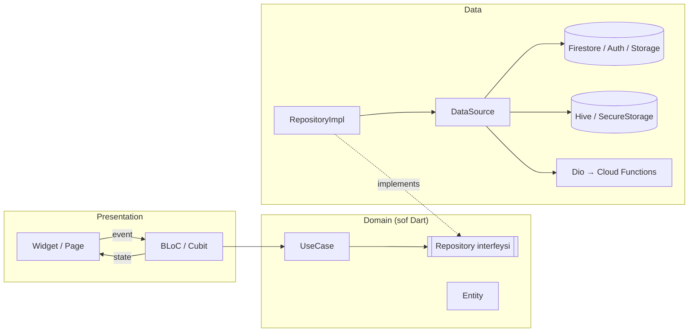
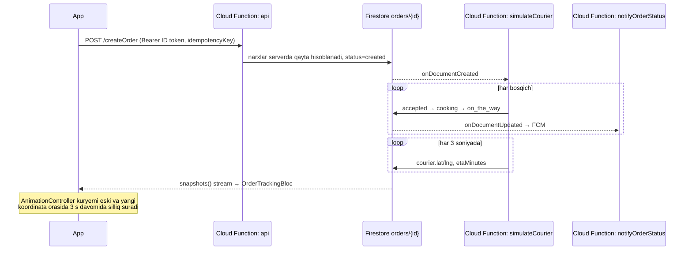

# Yetkaz — ovqat yetkazib berish ilovasi

[](https://github.com/sunnatillo01/yetkaz/actions/workflows/ci.yml)
[](https://codecov.io/gh/sunnatillo01/yetkaz)


**Yetkaz** — mijoz restoranlardan ovqat buyurtma qiladigan va kuryerni xaritada real vaqtda kuzatadigan Flutter ilova.
Loyiha Clean Architecture, BLoC, Firebase (Auth, Firestore, Functions, FCM, Storage) va to'liq CI/CD bilan qurilgan.
Uch til (o'zbek, rus, ingliz), kun/tun rejimi, offline kesh va 180+ avtomatik test.


## Skrinshotlar

| Bosh sahifa | Restoran | Savatcha | Kuzatish |
|---|---|---|---|
|  |  |  |  |
|  |  |  |  |

Demo (30–60 s): `docs/demo.gif`

> Skrinshotlar `docs/screenshots/` papkasiga qo'shiladi (yorug' va qorong'i mavzu).

## Imkoniyatlar

- **Kirish:** telefon raqam (`+998 90 123 45 67` maskasi), SMS kod (60 s taymer, Android'da avtomatik o'qish), yangi foydalanuvchi uchun ism.
- **Bosh sahifa:** joriy manzil, aksiya karuseli, kategoriyalar, restoranlar (10 tadan cheksiz scroll, pull-to-refresh), filtrlar (kategoriya, reyting 4+, yetkazish narxi, saralash: mashhur/yaqin/reyting).
- **Qidiruv:** 400 ms debounce, restoran va taom nomlari bo'yicha, oxirgi 5 ta qidiruv.
- **Restoran:** yig'iladigan `SliverAppBar`, Hero animatsiya, sticky tablar ↔ scroll sinxron, taom tafsilotlari (qo'shimchalar, miqdor), yopiq restoran ogohlantirishi.
- **Savatcha:** Hive'da saqlanadi, bitta restoran qoidasi, swipe bilan o'chirish, int summalar, minimal summa, badge.
- **Checkout:** xaritada pin + reverse geocoding, "Mening joylashuvim", manzil tafsilotlari, Naqd/Karta (simulyatsiya), izoh, ikki marta bosishdan himoya (idempotentlik kaliti).
- **Real vaqtda kuzatish:** stepper, kuryer markeri silliq harakatlanadi, marshrut chizig'i, ETA, `created` holatida bekor qilish, fonga o'tganda stream to'xtaydi.
- **Push:** holat o'zgarganda FCM, ilova ochiq bo'lsa local notification, bosilganda buyurtma ochiladi (ilova yopiq bo'lsa ham).
- **Profil:** avatar (galereya/kamera → Storage), buyurtmalar tarixi (faol/tugagan, pagination), qayta buyurtma, saqlangan manzillar, hisobni o'chirish.
- **Sozlamalar:** til va mavzu qayta ishga tushirmasdan almashadi, bildirishnomalar, versiya va flavor.
- **Deep link:** `yetkaz://order/123` va `https://yetkaz.app/order/123`.

## Arxitektura

Feature-first Clean Architecture. Qatlamlar faqat ichkariga bog'lanadi: `presentation → domain ← data`.



Qoidalar:

1. `domain` hech qanday Flutter yoki Firebase paketini import qilmaydi (faqat `freezed_annotation`, `fpdart`, `injectable` annotatsiyalari).
2. Widget repository yoki Firebase'ga to'g'ridan-to'g'ri murojaat qilmaydi — faqat BLoC orqali.
3. Har bir BLoC holati freezed union: `initial / loading / success / failure`.
4. Xatolar data qatlamida `Failure` ga aylanadi (`NetworkFailure`, `ServerFailure`, `CacheFailure`, `AuthFailure`, …); foydalanuvchiga faqat ARB'dagi tushunarli matn ko'rsatiladi.
5. Hardcoded matn va rang yo'q: matnlar `lib/core/l10n/arb`, ranglar `AppTheme` + `AppColors` (`ThemeExtension`).

### Papka tuzilmasi

```
lib/
├── main_dev.dart / main_prod.dart   # flavor entry point'lar
├── bootstrap.dart                   # Firebase, Crashlytics, Hive, DI, router
├── app.dart                         # MaterialApp.router, til/mavzu
├── core/
│   ├── config/        # AppConfig, Firebase options (--dart-define)
│   ├── di/            # get_it + injectable
│   ├── network/       # Dio interceptorlar (auth/401 refresh, xato turlari), internet holati
│   ├── error/         # Exception → Failure mapping
│   ├── router/        # go_router, redirect, StatefulShellRoute
│   ├── theme/         # light/dark, AppColors
│   ├── l10n/          # ARB (uz, ru, en)
│   ├── storage/       # Hive qutilari, secure storage
│   ├── notifications/ # FCM + local notifications
│   ├── utils/         # formatter, validator, debouncer
│   └── widgets/       # shimmer, error/empty view, internet banneri
└── features/
    ├── onboarding/  auth/  home/  search/  restaurant/  cart/
    ├── address/  checkout/  order_tracking/  profile/  settings/
    └── <feature>/{data,domain,presentation}
functions/            # Cloud Functions (TypeScript): API, simulyator, push, seed
firestore.rules       # Security Rules
```

### Real vaqtda kuzatish qanday ishlaydi



- Ilova fonga o'tsa (`AppLifecycleListener.onPause`) BLoC Firestore obunasini bekor qiladi, qaytganda qayta ulanadi.
- `delivered`/`cancelled` holatida obuna avtomatik yopiladi.

### Token qanday yangilanadi

1. Kirishdan keyin Firebase ID token `flutter_secure_storage`ga yoziladi.
2. `AuthInterceptor` (Dio, `QueuedInterceptor`) har so'rovga `Authorization: Bearer <token>` qo'shadi.
3. Server `401` qaytarsa: `user.getIdToken(true)` bilan yangi token olinadi, saqlanadi va asl so'rov **bir marta** qayta yuboriladi. `QueuedInterceptor` parallel so'rovlar uchun bitta refresh kafolatlaydi.
4. Token olinmasa xato `AuthFailure`ga aylanadi.

## Texnologiyalar va "Nega aynan shu?"

| Vazifa | Paket | Nega? |
|---|---|---|
| State management | `flutter_bloc`, `bloc_concurrency` | Event → state oqimi aniq, `bloc_test` bilan oson test qilinadi; `droppable` ikki marta bosishni bloklaydi. |
| Modellar | `freezed`, `json_serializable` | Immutable modellar, union holatlar va `copyWith` qo'lda yozilmaydi. |
| Natija turi | `fpdart` (`Either<Failure, T>`) | Xatolar tipda ko'rinadi, `try/catch` UI'ga chiqmaydi. |
| Tarmoq | `dio`, `pretty_dio_logger` | Interceptorlar: token, 401 refresh, xatolarni turlash; logger faqat dev'da. |
| DI | `get_it`, `injectable` | Bog'liqliklar annotatsiya bilan generatsiya qilinadi, testda almashtirish oson. |
| Navigatsiya | `go_router` | Deklarativ redirect (auth guard), deep link, `StatefulShellRoute` bilan tab holati saqlanadi. |
| Lokal saqlash | `hive_ce`, `flutter_secure_storage` | Hive tez va sof Dart; token esa faqat Keychain/Keystore'da. |
| Backend | Firebase (Auth, Firestore, Functions, FCM, Storage, Crashlytics, Analytics) | Real vaqt stream'lari, telefon auth va serverless logika bitta platformada. |
| Xarita | `google_maps_flutter`, `geolocator`, `geocoding` | Marker/polyline API, joylashuv ruxsatlari va reverse geocoding. |
| Bildirishnoma | `flutter_local_notifications` | Ilova ochiq bo'lganda FCM xabarini ko'rsatish. |
| Lokalizatsiya | `flutter_localizations`, `intl` (ARB) | Rasmiy yechim, plural va placeholder'lar bilan. |
| UI | `cached_network_image`, `shimmer`, `flutter_svg` | Rasm keshi va `memCacheWidth`, skeleton loader, vektor illyustratsiyalar. |
| Internet holati | `connectivity_plus` | Offline banner va internet qaytganda avtomatik yangilash. |
| Test | `bloc_test`, `mocktail`, `integration_test` | BLoC holatlari ketma-ketligini tekshirish, kod generatsiyasiz mock. |
| Kod sifati | `very_good_analysis` | Qat'iy lint qoidalari, CI'da `--fatal-infos`. |

## Ishga tushirish

### Talablar

- Flutter 3.47 (stable), Dart 3.13
- Node.js 22, Firebase CLI (`npm i -g firebase-tools`)
- Android SDK 37, JDK 17; iOS uchun Xcode 16+

### 1. Firebase loyihalari

Ikki loyiha yarating: `yetkaz-dev` va `yetkaz-prod` (Functions uchun **Blaze** tarifi kerak). Har birida yoqing:

- Authentication → **Phone**
- Firestore, Storage, Cloud Messaging, Crashlytics
- Android ilovalar: `uz.yetkaz.app.dev` (dev) va `uz.yetkaz.app` (prod), SHA-1/SHA-256 qo'shing (Phone auth uchun)
- iOS ilovalar: `uz.yetkaz.app.dev` / `uz.yetkaz.app`, APNs kalitini yuklang

```bash
cp .firebaserc.example .firebaserc
cp env/dev.example.json env/dev.json     # qiymatlarni Firebase Console → Project settings dan oling
cp env/prod.example.json env/prod.json
```

> `env/*.json`, `google-services.json`, `GoogleService-Info.plist`, `key.properties` Git'ga **qo'shilmaydi** (`.gitignore`).
> Firebase sozlamalari Dart'ga `--dart-define-from-file` orqali beriladi, shuning uchun `google-services.json` shart emas.

### 2. Google Maps kaliti

- Android: `android/local.properties` ga `MAPS_API_KEY=...` qo'shing (yoki `MAPS_API_KEY` env o'zgaruvchisi).
- iOS: `ios/Flutter/Secrets.xcconfig` yarating: `MAPS_API_KEY=...` va uni `Debug.xcconfig`/`Release.xcconfig` ichida `#include? "Secrets.xcconfig"` qiling.

### 3. Backend

```bash
firebase use dev
firebase deploy --only firestore:rules,firestore:indexes,storage
cd functions && npm ci && npm run deploy
GOOGLE_APPLICATION_CREDENTIALS=../service-account.json GCLOUD_PROJECT=yetkaz-dev npm run seed
```

### 4. Ilova

```bash
flutter pub get
flutter gen-l10n
dart run build_runner build

# dev
flutter run --flavor dev -t lib/main_dev.dart --dart-define-from-file=env/dev.json
# prod
flutter run --flavor prod -t lib/main_prod.dart --dart-define-from-file=env/prod.json
```

### Emulator bilan (Firebase Emulator Suite)

```bash
firebase emulators:start --project yetkaz-dev
(cd functions && FIRESTORE_EMULATOR_HOST=localhost:8080 GCLOUD_PROJECT=yetkaz-dev npm run seed)
flutter run --flavor dev -t lib/main_dev.dart --dart-define-from-file=env/dev.json \
  --dart-define=USE_FIREBASE_EMULATOR=true \
  --dart-define=FUNCTIONS_BASE_URL=http://10.0.2.2:5001/yetkaz-dev/europe-west1/api
```

### iOS flavor'lar

Android flavor'lari `build.gradle.kts`da tayyor. iOS uchun Xcode'da bir marta:

1. `Runner` target → *Duplicate* emas, **Build Configurations**: `Debug-dev`, `Release-dev`, `Debug-prod`, `Release-prod`.
2. *Product → Scheme → New Scheme*: `dev` va `prod` (Flutter `--flavor` nomi scheme nomiga teng bo'lishi kerak).
3. Har konfiguratsiya uchun `PRODUCT_BUNDLE_IDENTIFIER` (`uz.yetkaz.app.dev` / `uz.yetkaz.app`) va `Runner.entitlements` ni tanlang.

## Testlar

```bash
flutter test --coverage
dart run tool/coverage.dart 70        # domain + BLoC qamrovi (hozir ~88%)
(cd functions && npm test)            # narx hisobi, marshrut, push matnlari

# Integration (emulator ishlab turgan bo'lishi kerak):
flutter test integration_test --flavor dev --dart-define-from-file=env/dev.json \
  --dart-define=USE_FIREBASE_EMULATOR=true \
  --dart-define=FUNCTIONS_BASE_URL=http://10.0.2.2:5001/yetkaz-dev/europe-west1/api
```

| Tur | Nima | Soni |
|---|---|---|
| Unit | use case'lar, repository'lar (mock datasource), narx hisobi, validator, debouncer, interceptorlar, redirect | 95+ |
| BLoC | barcha BLoC/Cubit'lar: success, failure, bo'sh holatlar | 70+ |
| Widget | login formasi, savatcha, xato/bo'sh holat, internet banneri, stepper | 16 |
| Integration | login → restoran → savatcha → buyurtma → kuzatish | 1 |

## CI/CD

- **ci.yml** — har push/PR: `pub get` → kod generatsiyasi → `dart format --set-exit-if-changed` → `flutter analyze --fatal-infos` → `flutter test --coverage` → qamrov ≥ 70% → Codecov. Functions: `npm test`.
- **release.yml** — `main`ga merge: prod flavor, `--obfuscate --split-debug-info`, `--split-per-abi` APK → GitHub Releases (`v<version>`).

GitHub Secrets: `ENV_PROD_JSON`, `ANDROID_KEYSTORE_BASE64`, `ANDROID_KEY_PROPERTIES`, `MAPS_API_KEY`, `CODECOV_TOKEN`.
Birinchi uchtasi bo'lmasa, release workflow ogohlantirish bilan o'tkazib yuboriladi (yiqilmaydi). Ular qo'shilgach, *Actions → Release APK → Run workflow* bilan qo'lda ishga tushirish mumkin.

Ilova faqat GitHub Releases orqali APK sifatida tarqatiladi — Google Play / App Store'ga chiqarish loyiha doirasiga kirmaydi.

`ANDROID_KEY_PROPERTIES` namunasi:

```properties
storePassword=***
keyPassword=***
keyAlias=upload
storeFile=upload-keystore.jks
```

### Git qoidalari

- Branchlar: `main` (reliz), `develop`, `feature/<nom>`, `fix/<nom>`
- Conventional Commits: `feat(cart): add swipe to delete`, `fix(auth): handle expired otp`
- Har feature — alohida PR (shablon: `.github/pull_request_template.md`)

## Platforma eslatmalari

- **Android minSdk 24** (spetsifikatsiyada 23): Firebase Android BoM 35 kamida API 24 talab qiladi.
- **iOS 15.0+** (spetsifikatsiyada 13): Firebase iOS SDK 13 kamida iOS 15 talab qiladi.
- Flutter 3.47'da Material kutubxonasi `material_ui` paketiga ko'chgan — loyiha `package:material_ui/material_ui.dart` dan foydalanadi.

## Cheklovlar (ataylab)

- To'lov — faqat simulyatsiya (Naqd / Karta).
- Kuryer — Cloud Function simulyatori; marshrut to'g'ri chiziqqa yaqin egri (Directions API pullik).
- "Yaqin" saralash: Firestore masofa bo'yicha saralay olmaydi, shuning uchun eng mashhur 50 ta restoran masofa bo'yicha xotirada saralanadi va sahifalanadi.
- Qidiruv: Firestore'da full-text yo'q — seed skripti `searchKeywords` (restoran va taom nomlarining prefikslari) yozadi.

## Suhbatga tayyorgarlik — "Nega?"

- **Nega BLoC?** UI va biznes-logika to'liq ajraladi; holatlar union bo'lgani uchun har holat ekranda majburan ishlanadi; event transformer'lar (debounce, droppable, restartable) qo'lda taymer yozmasdan muammoni hal qiladi.
- **Nega Clean Architecture?** Domain sof Dart — Firebase'ni almashtirsak ham use case va testlar o'zgarmaydi; repository mock bilan har qatlam alohida test qilinadi.
- **Narx nega serverda?** Klient yuborgan summaga ishonib bo'lmaydi: `createOrder` menyudan narxlarni o'qib, xizmat haqini (ilova bilan bir xil formula) qayta hisoblaydi.
- **Ikki buyurtma qanday oldi olinadi?** UI'da `droppable()`, serverda esa idempotentlik kaliti hujjat ID'si sifatida — qayta so'rov o'sha buyurtmani qaytaradi.
- **Offline?** Firestore keshi + birinchi sahifa Hive'da; internet qaytsa `ConnectivityCubit` ro'yxatni avtomatik yangilaydi.
